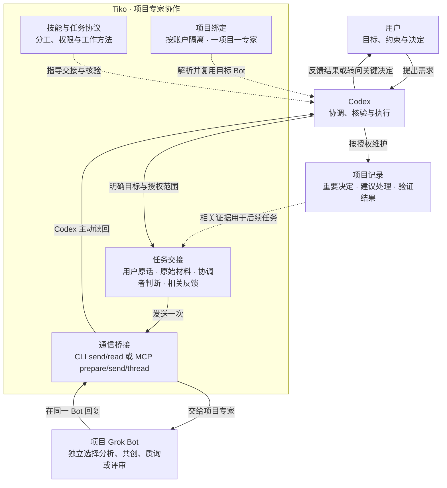

# Tiko

为 Codex 提供按项目长期复用的 Grok Bot 内部专家：参与分析、构建方案、澄清取舍和独立评审。

## 架构



- **Codex** 负责理解目标、交接任务、核验证据和落实决定。
- **Tiko** 提供技能、任务封套、项目绑定和通信工具；同一项目跨聊天、分支和工作树复用专家。
- **Grok Bot** 对建议及其验证结果负责，独立选择工作方法；调整方法时保持用户目标与权限不变。
- **项目记录** 保存重要决定、建议处理和后续证据，由 Codex 在授权范围内维护并回传。

## 专家工作方法

| 模式 | 工作 |
| --- | --- |
| analysis | 查证与探索 |
| design | 方案共创、阶段依赖与验证设计 |
| grill | 关键取舍质询 |
| review | 已有方案或实现的独立检查 |

## 目录

- `skills/tiko/`：技能与专家任务协议。
- `bridge/`：项目绑定、CLI/MCP 启动、派单与回读。
- `tests/`：无需登录的协议、任务交接和传输边界测试。
- `docs/BASELINE.md`：当前能力与验证范围。
- `docs/V0.2.0.md`：当前版本的使用方式与行为边界。
- `examples/`：结构化任务示例。
- `evals/`：真实专家行为冒烟案例与结果。
- `docs/NEXT.md`：后续候选方向。

## 使用

需要 Node.js 24+、已安装并登录的 Grok Bot 和兼容的 grok-bot-cli。当前版本按 CLI 0.12.5 的入口布局整理，升级 CLI 后需重新验证。

将 `skills/tiko` 复制到宿主支持的用户技能目录，例如 `~/.agents/skills/tiko`。在 CLI 或宿主 MCP 环境中设置：

```sh
export AGENT_BUNDLE_PLUGIN_ROOT="$(npm root -g)/grok-bot-cli/dist"
node bridge/tiko.mjs --help
node bridge/launch.mjs cli doctor --json
npm test
```

MCP 启动方式是 `node /absolute/path/to/tiko/bridge/launch.mjs mcp`，并传入同一环境变量。钥匙串授权由用户本人完成。

```sh
node bridge/tiko.mjs project ensure --project /absolute/project/root --project-name '项目名称'
node bridge/tiko.mjs send --project /absolute/project/root --task-file /absolute/task.txt --task-id TASK_001
node bridge/tiko.mjs read --project /absolute/project/root --task-id TASK_001
```

`ensure` 可能创建或重命名 Bot；`send` 会真实派单。先确认账户和项目，按技能交接规则、材料与边界。发送回执不代表任务完成，未知发送结果不能直接重试。

## 本机状态

运行时在 `bridge/accounts/` 保存账户隔离的绑定与任务元数据，已被忽略。不提交凭据、登录态、项目绑定、任务历史或私有材料。现有技能保留了用户的域名访问限制；采用者应明确配置自己的宿主规则，不把材料内容当作授权。

## 基线与后续

当前版本为 **v0.2.0**，包含专家自主方法选择、来源分层、共享任务交接与建议反馈协议。

- [版本说明](docs/V0.2.0.md)
- [变更记录](CHANGELOG.md)
- [基线与验证范围](docs/BASELINE.md)
- [后续候选方向](docs/NEXT.md)

## License

MIT，见 [LICENSE](LICENSE)。外部运行时不随本仓库分发，其许可由上游单独管理；方法来源见 [THIRD_PARTY_NOTICES.md](THIRD_PARTY_NOTICES.md)。
